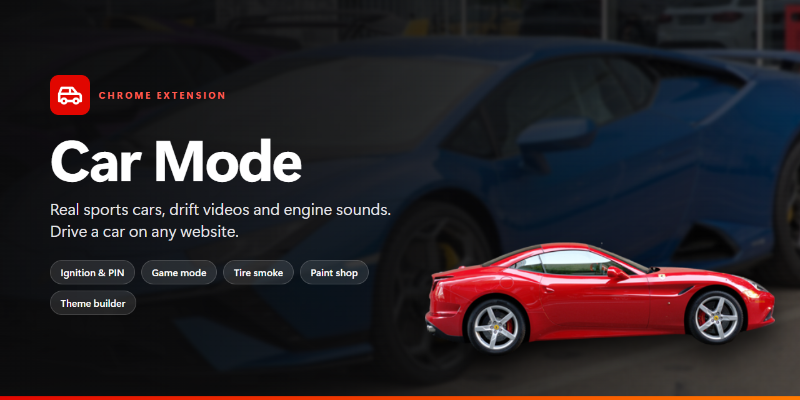
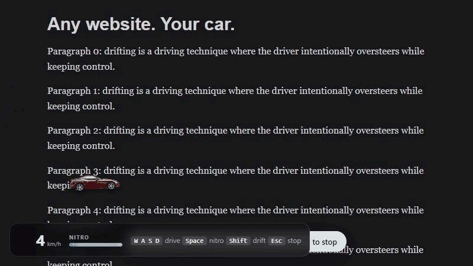
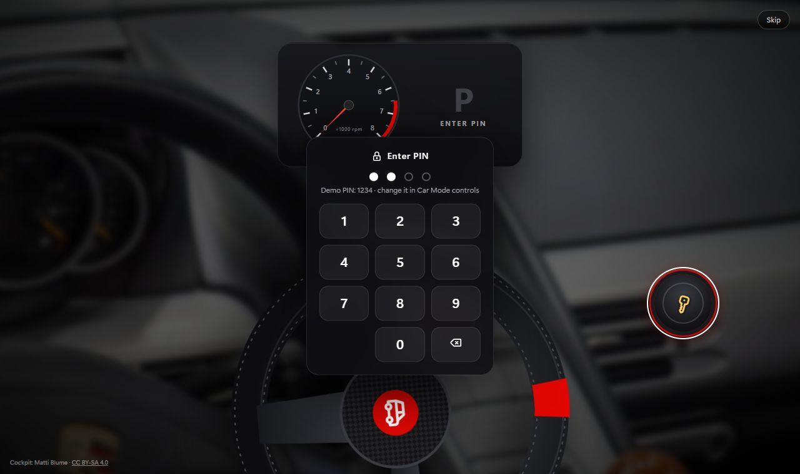
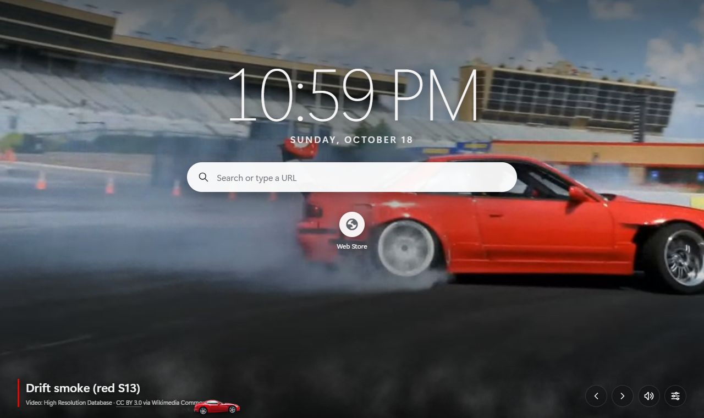
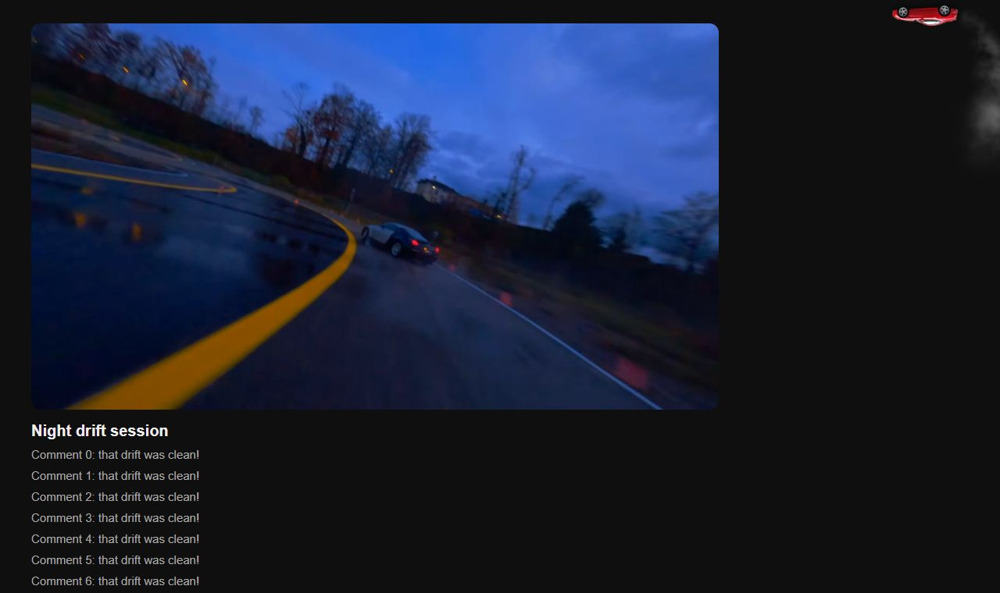
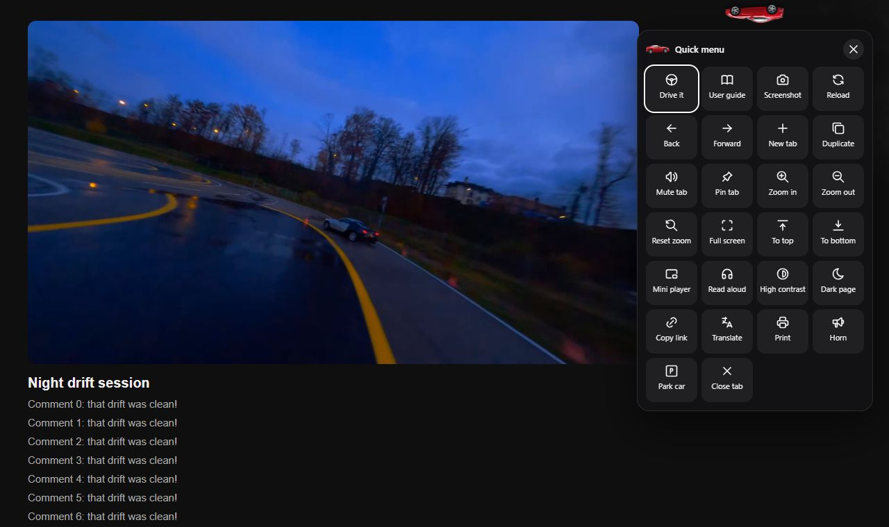
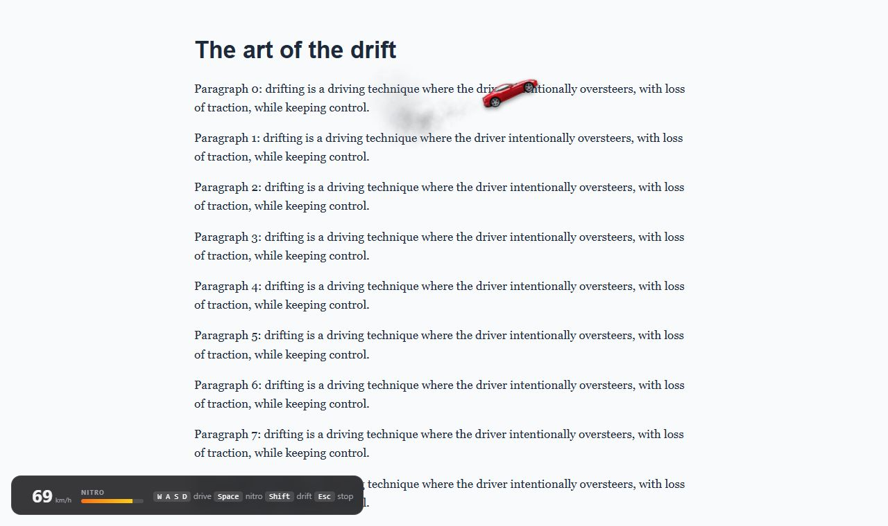
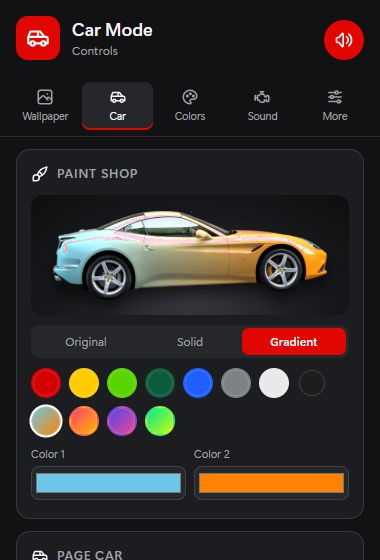
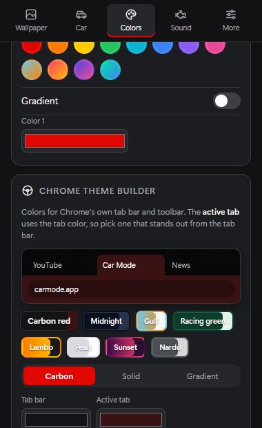
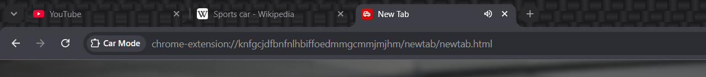

<p align="center">
  
</p>

<p align="center">
  <a href="https://github.com/BuiltByBowas/Car-Mode/releases/latest"></a>
  
  <a href="LICENSE"></a>
  
</p>

<p align="center">
  <a href="https://github.com/BuiltByBowas/Car-Mode/releases/latest/download/car-mode.zip"><b>⬇ Download Car Mode</b></a>
  &nbsp;·&nbsp;
  <a href="https://github.com/BuiltByBowas/Car-Mode/releases/latest/download/car-mode-theme.zip">Chrome theme</a>
  &nbsp;·&nbsp;
  <a href="#install">Install guide</a>
  &nbsp;·&nbsp;
  <a href="#features">Features</a>
</p>

---

**Car Mode** turns Chrome into a garage. Real sports-car photos and drift videos fill your new tab, a real Ferrari drives around every website trailing tire smoke, and real engine recordings play when you start Chrome, open tabs and close them. When you want to play, take the wheel: drive the car anywhere on any page with **W A S D**, hit **Space** for nitro and **Shift** to drift.

No accounts. No servers. No tracking. Everything runs in your browser.

<p align="center">
  
  <br><sub>Game mode: drive on any website. Drifting leaves tire smoke, and the page scrolls when you drive into the edge.</sub>
</p>

## Contents

- [Features](#features)
- [Screenshots](#screenshots)
- [Install](#install)
- [Controls & shortcuts](#controls--shortcuts)
- [Permissions & privacy](#permissions--privacy)
- [For developers](#for-developers)
- [Credits & license](#credits--license)

## Features

| | |
|---|---|
| 🔑 **Ignition** | The first tab after Chrome starts is a Porsche cockpit. Your pointer becomes a key: insert it, enter your PIN (demo `1234`), and the real engine fires while the tachometer sweeps. The mouse steers the wheel. |
| 🎬 **Live new tab** | Drift videos with smoke rolling across the page, or 13 sports-car photos (Lamborghini, Ferrari, McLaren, Porsche, Audi), with a clock, search and your top sites. |
| 🏎️ **Page car** | A real Ferrari laps every website's edges like a stunt track and drifts through the corners. Or set it to follow your active tab. |
| 🎮 **Game mode** | Drive the car anywhere on any page: WASD, Space for nitro, Shift to drift. Includes a speedometer and nitro bar, and the page scrolls when you drive into the edge. |
| ⚡ **Quick menu** | Click the car for 26 actions: screenshot, reload, zoom, full screen, mini player, read aloud, dark page, high contrast, translate, copy link, print, mute, pin and more. |
| 🎨 **Paint shop** | Repaint the car any color or gradient (Gulf, Sunset, Galaxy…), keeping its real reflections. |
| 🌈 **Accent colors** | Any color or gradient for Car Mode's buttons, new tab, ignition screen and steering wheel. |
| 🧩 **Chrome theme + builder** | A carbon tab bar with a clearly highlighted active tab, plus a builder that makes your own theme with a live preview. |
| 🔊 **Real sounds** | Engine start, a nitro burst for new tabs, a car driving away when you close a tab. Pick your own sound for every event. |
| 📖 **User guide** | Opens on first install and explains everything with screenshots. It can be saved as a PDF. |

## Screenshots

<table>
  <tr>
    <td width="50%"><br><sub><b>Ignition</b>: key, PIN and engine start</sub></td>
    <td width="50%"><br><sub><b>New tab</b>: drift video wallpaper with smoke</sub></td>
  </tr>
  <tr>
    <td><br><sub><b>Page car</b>: laps any website, YouTube included</sub></td>
    <td><br><sub><b>Quick menu</b>: 26 actions, fully keyboard-accessible</sub></td>
  </tr>
  <tr>
    <td><br><sub><b>Game mode</b>: speedometer and nitro bar</sub></td>
    <td>
      
      <br>
      <sub><b>Paint shop</b> and <b>theme builder</b></sub>
    </td>
  </tr>
  <tr>
    <td colspan="2"><br><sub><b>Chrome theme</b>: carbon tab bar, clearly highlighted active tab</sub></td>
  </tr>
</table>

## Install

### Option A — Download (recommended)

1. Download **[car-mode.zip](https://github.com/BuiltByBowas/Car-Mode/releases/latest/download/car-mode.zip)** and unzip it to a folder you'll keep, for example `Documents\Car Mode`.
2. Open `chrome://extensions` and turn on **Developer mode** (top right).
3. Click **Load unpacked** and select the unzipped folder (the one containing `manifest.json`).
4. Open a new tab. If Chrome asks to keep the new page, choose **Keep it**. The user guide opens automatically.
5. *Optional:* download **[car-mode-theme.zip](https://github.com/BuiltByBowas/Car-Mode/releases/latest/download/car-mode-theme.zip)**, unzip it, and **Load unpacked** that folder too, for the carbon Chrome theme.

> Keep the folder after installing. Chrome runs unpacked extensions from it, so deleting it removes Car Mode.

### Option B — From source

```bash
git clone https://github.com/BuiltByBowas/Car-Mode.git
```

Then **Load unpacked** the `Car-Mode` folder, and optionally `Car-Mode/theme`.

### Updating

Download the new ZIP and replace the folder's contents (or `git pull`), then click ↻ on Car Mode in `chrome://extensions`.

## Controls & shortcuts

**Game mode**: click the car → **Drive it**, or press `Alt+Shift+D`.

| Key | Action |
|---|---|
| `W` / `↑` | Accelerate |
| `S` / `↓` | Brake, then reverse |
| `A` `D` / `←` `→` | Steer |
| `Space` (with `W`) | Nitro boost (the blue bar refills) |
| `Shift` | Handbrake drift |
| `H` | Horn |
| `Esc` | Stop driving (all keys go back to normal) |

**Everywhere**

| Shortcut | Action |
|---|---|
| `Alt+Shift+C` | Open the car's quick menu |
| `Alt+Shift+D` | Start / stop game mode |
| `←` `→` on the new tab | Previous / next wallpaper |
| Click the toolbar icon | Car Mode controls (side panel) |

You can change shortcuts at `chrome://extensions/shortcuts`.

## Permissions & privacy

Car Mode collects **no data**. It has no accounts, no analytics and no network requests of its own. Settings live in your browser's local storage.

| Permission | Why |
|---|---|
| Read & change site data (`<all_urls>`) | Show the car and smoke on websites; take screenshots of the current page |
| `storage` | Save your settings, paint and PIN locally |
| `downloads` | Save screenshots and theme-builder themes to your Downloads folder |
| `offscreen` | Play engine sounds in the background so they work across tabs |
| `sidePanel` | The Car Mode controls |
| `topSites`, `favicon`, `search` | Most-visited shortcuts and the search box on the new tab |

The car doesn't run on `chrome://` pages or the Chrome Web Store, because Chrome blocks extensions there.

## For developers

No build step. It's plain JavaScript, HTML and CSS with no dependencies.

```
manifest.json         Manifest V3
background.js         engine sounds for browser events, quick-menu actions, tab positions
offscreen/            hidden audio page
content/car.js        page car: roaming, follow-tab, game mode, smoke and quick menu
newtab/               new tab (wallpapers, smoke) and ignition screen
sidepanel/            control center (wallpaper, car & paint, colors & theme builder, sound, more)
guide/                user guide (opens on install) and its screenshots
shared/               settings, sound clips, audio player, smoke renderer, colors/paint/theme generator
assets/               photos, videos, cockpit, car cutout, recordings, smoke textures, icons
theme/                the Chrome theme (a separate extension)
docs/                 README images
scripts/package.py    builds the release ZIPs
```

**Build a release:**

```bash
python scripts/package.py   # → dist/car-mode.zip and dist/car-mode-theme.zip
```

## Roadmap

- 🔧 Garage: repair and customize a car, then set it as your wallpaper
- 🧑‍🔧 A mechanic companion with car-care tips
- 🔎 Car and bike search

## Credits & license

- **Photos, videos and engine recordings:** [Wikimedia Commons](https://commons.wikimedia.org/) contributors under free licenses (CC BY, CC BY-SA, CC0, public domain). Every file, author and license is listed in **[CREDITS.md](CREDITS.md)** and in the extension (**Controls › More › Credits**).
- **Icons:** [Tabler Icons](https://tabler.io/icons) (MIT).
- **Smoke textures, carbon texture, steering wheel and gauges:** made for this project.
- **Code:** [MIT License](LICENSE).

<p align="center"><sub>Made with ❤️ for car people. Drive safe.</sub></p>
